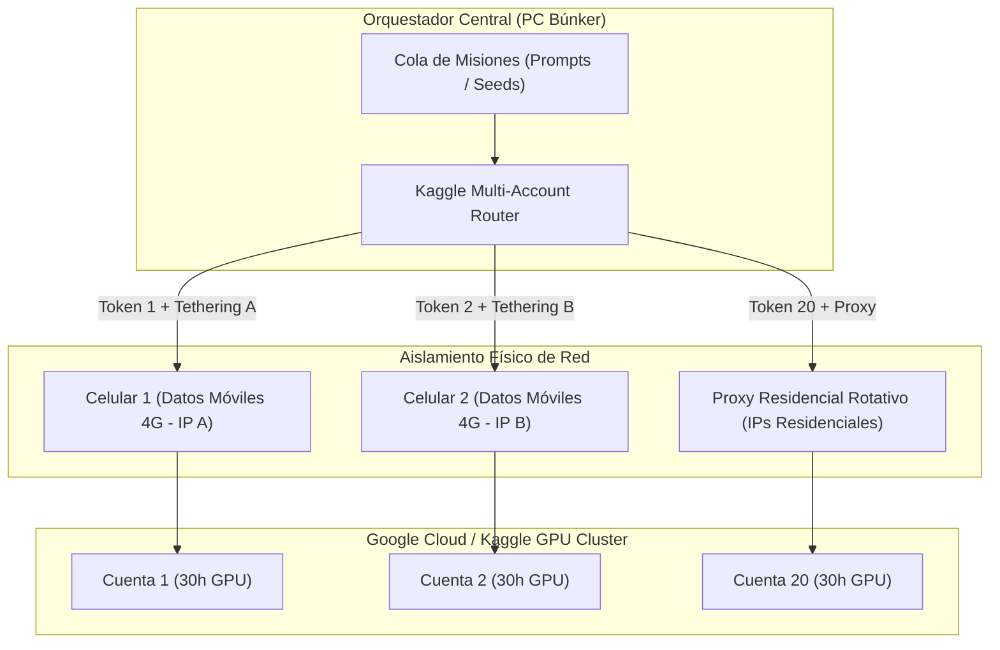

# 🌐 CloneCinema — Estrategia de Enjambre Multi-Identidad en Kaggle

> **Autores:** Wily (Director General) & Beatriz Serie X Elite (Co-CEO Tecnológica)  
> **Proyecto:** CloneCinema / Generación Cinematográfica Autónoma  
> **Fecha:** 15 de Noviembre, 2026  
> **Estado:** Documento Estratégico y de Arquitectura Operativa

---

## 🎯 1. Visión y Objetivo Estratégico

El objetivo de este plan es escalar la capacidad de cómputo GPU libre de Kaggle (30 horas semanales de GPU T4 por cuenta) multiplicándola a través de un **Enjambre de Identidades Funcionales**.

* **Fase Actual (Fase 1 - Calibración):** Operación estricta con **1 sola cuenta** (`wilycol1492@gmail.com`) hasta dejar 100% blindada la orquestación CLI, el pipeline de video encadenado (*Frame-Chaining*) con Wan 2.1 I2V y la consistencia de personajes.
* **Fase Futura (Fase 2 - Escalamiento Industrial):** Despliegue del enjambre para alcanzar hasta **600 horas semanales de GPU libre** (~150 minutos de video cinemático / 900 clips de 10s semanales).

---

## ⚠️ 2. Análisis Forense de Riesgos de Red y Detección de Kaggle

### ¿Puede Kaggle detectarnos si operamos 20 cuentas desde la misma red Wi-Fi?
**SÍ, existe un riesgo significativo si se hace sin aislamiento.**

1. **Misma IP Pública:** Tu router Wi-Fi asigna una única IP pública a todos los dispositivos de la casa. Si 20 cuentas distintas envían peticiones a la API de Kaggle (`kaggle kernels push`) desde la misma IP y ejecutan scripts con patrones similares, los filtros de Google Cloud y Cloudflare activan alertas de *Sybil Attack* o uso indebido de GPU.
2. **El Filtro Crítico de Kaggle (Verificación Telefónica):**
   * Kaggle solo otorga las 30 horas semanales de GPU a cuentas verificadas mediante **SMS con número telefónico único real** (no acepta VoIP virtuales tipo TextNow). Cada cuenta requiere su propia línea celular activa.
3. **Huella de Dispositivo (Browser Fingerprinting):**
   * En interfaz web, Kaggle lee canvas, WebGL y extensiones. A través de la CLI (`kaggle.json`), la huella se reduce drásticamente a la IP y el User-Agent.

---

## 📱 3. La Pregunta del Consumo de Datos Móviles (4G / 5G)

> **"Si utilizáramos 20 teléfonos móviles con datos, ¿consumiría muchos datos la generación de videos?"**

### 💡 RESPUESTA TÉCNICA: NO, el consumo es MINÚSCULO (< 1% de un plan típico).

#### ¿Por qué? Arquitectura Cloud-Native:
* El modelo Wan 2.1 I2V (14B) pesa **~15 a 20 GB**, pero **se descarga y ejecuta completamente en los servidores de Google (Kaggle)**, NO en tu teléfono ni en tu PC.
* **Datos que salen de tu teléfono al enviar la orden (`push`):**
  * El archivo `main.py` + `kernel-metadata.json`: **~5 a 10 Kilobytes** (menos que un mensaje de WhatsApp).
* **Datos que se consumen mientras renderiza:** **0 Bytes** (el proceso corre en la nube de Google durante 8-30 minutos).
* **Datos que bajan al descargar el video final (`output_video.mp4`):**
  * Un video vertical HD de 10 segundos pesa entre **6 MB y 15 MB**.

#### 📈 Balance de Consumo Real:
* **1 video encadenado de 10 segundos:** ~10 MB de datos móviles.
* **50 videos a la semana:** ~500 MB (¡apenas medio Gigabyte!).
* Cualquier plan móvil prepago o pospago estándar de 10 GB soporta fácilmente **más de 1,000 ciclos de video** sin agotarse.

---

## 🛡️ 4. Soluciones Físicas y de Red para Blindar el Multi-Cuentas

Para garantizar inmunidad contra baneos y operar con seguridad militar, proponemos 3 capas de protección física:

### Opción 1: Datos Móviles y Rotación CGNAT (La Mejor Solución Física)
* **Principio:** Los operadores celulares usan **CGNAT (Carrier-Grade NAT)**. Esto significa que miles de celulares comparten el mismo bloque de IPs móviles dinámicas que cambian todo el tiempo. Para Kaggle, el tráfico parece el de un usuario móvil ordinario.
* **Modo Avión (Rotador de IP instantáneo):** Activar y desactivar el modo avión durante 5 segundos fuerza al operador celular a asignarle al teléfono una **nueva IP pública limpia**.
* **Ejecución:** Teléfonos compartiendo internet por USB Tethering o hotspot con scripts ligeros.

### Opción 2: Proxies Residenciales Rotativos (Solución de Software en 1 sola PC)
* En lugar de 20 teléfonos físicos, se configura en la PC un enrutador que dirija cada llamada de la CLI de Kaggle a través de un proxy residencial (Bright Data, Webshare o IPRoyal).
* Cada petición sale con una IP residencial distinta y limpia, eliminando la correlación entre cuentas.

### Opción 3: Desfase y Comportamiento Orgánico (Anti-Bot)
1. **Nunca disparar en ráfaga:** El enrutador debe aplicar un retraso aleatorio (*jitter*) de **2 a 5 minutos** entre el lanzamiento de una cuenta y la siguiente.
2. **Nombres de Kernels Diferenciados:** En lugar de llamar a todos `clonecinema-wan-i2v`, variar los slugs: `cinema-engine-v1`, `studio-render-ai`, `story-scene-flow`.
3. **Privacidad Obligatoria:** Los kernels deben ser estrictamente `"is_private": true`. Los kernels privados no aparecen en el feed público ni compiten en rankings.

---

## 🧭 5. Recomendación de la Co-CEO (Plan de Ruta Inmediato)

1. **Paso Inmediato:** Continuar en la cuenta principal `wilycol1492` hasta tener el generador de videos en un nivel de automatización donde sólo pasemos un guión y nos devuelva el video final listo y ensamblado.
2. **Paso 2:** Probar la primera cuenta secundaria (Identidad #2) usando conexión compartida de datos móviles o un entorno aislado para validar el flujo sin interferir con la cuenta madre.
3. **Paso 3:** Una vez validadas ambas, estructurar el despachador automático `kaggle_farm_router.py` en nuestro búnker.
